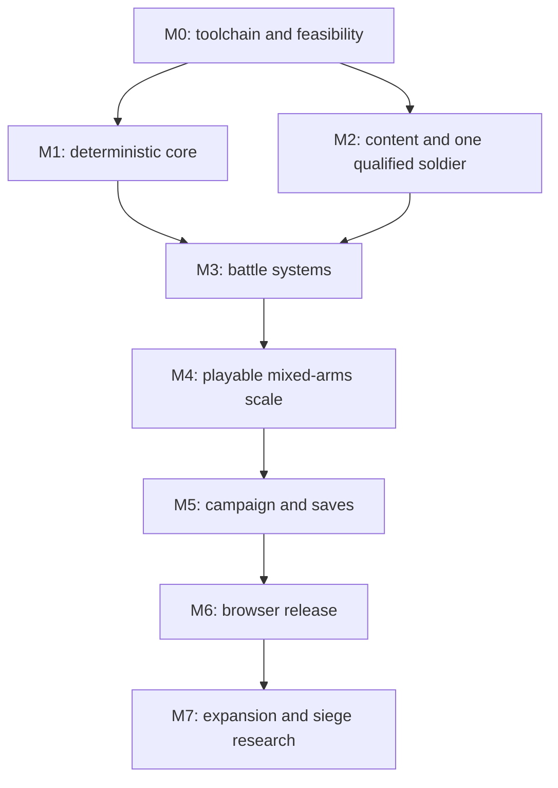

# Implementation roadmap

Updated 2026-10-11. **All engine milestones are unstarted.** Completed planning artifacts: subsystem contracts, ADRs, reusable asset skill, documentation checks, and a narrow Blender equipment experiment. No milestone is complete because its plan exists.

Schedule by evidence and dependencies rather than promised calendar dates; team capacity and source-art availability are unknown. One implemented vertical slice is more valuable than scaffolding every package. Task IDs below can become repository issues later; they are not existing GitHub issues.

## Dependency graph

Asset qualification and core mechanics can proceed independently after M0, but integration must happen before a large catalog/world is built.

## M0 — Feasibility, tooling and evidence

Owner roles: engine/rendering engineer and technical artist; roles are not assigned people.

- **ENG-001:** pin Node/package manager/TypeScript/Vite/Three.js and lockfile; strict types, formatting, import-boundary checks, build commands. Record exact versions and licenses.
- **ENG-002:** compose a minimal browser scene, module worker, pause/dispose lifecycle, telemetry export and base-path build. Use real transferable buffers early.
- **ART-001:** select one compatible licensed rig/body/animation source revision; inspect actual models/clips, record missing equipment and motion.
- **PERF-001:** create renderer-only equipped/animated crowd fixture, compare basic skinning and a credible instanced animation path; include attachments/terrain/shadows.
- **OPS-001:** verify a static build under `/vibe-banner-band/`; keep production release separate from prototype deployment.
- **ADR-001:** record engine evidence and either confirm Three.js or conduct the Godot comparison defined in ADR 0001. Document animation-path recommendation without claiming final 2,000-unit combat performance.

Exit: reproducible build/toolchain, initial asset import, actual browser telemetry and base-path smoke; named target hardware selected or access gap recorded. M0 may use a primitive core diagnostic but cannot use it as the final render qualification.

## M1 — Deterministic headless core

Depends on M0 tooling. Owner role: simulation engineer.

- **SIM-001:** numeric profile, bounds, signed rounding, deterministic vector math and fixed tick clock; golden edge vectors.
- **SIM-002:** stable IDs/generations, typed-array stores, capacity/overflow rules and staged writes.
- **SIM-003:** pin PRNG algorithm/streams, record seeds/state and golden outputs.
- **SIM-004:** validated command queue with stable ordering/duplicate/late policy.
- **SIM-005:** canonical checkpoint serialization, content/rules identity, state hashes and first-divergence tooling.
- **SIM-006:** headless/browser replay matrix including render-rate and worker-timing perturbations.

Exit: a small moving/interacting scenario reproduces across declared runtimes, save/restore preserves continuation, arithmetic limits are tested. No engine physics or renderer imports in core. Record unsupported runtimes rather than claiming universal determinism.

## M2 — Content compiler and one qualified soldier

Depends on M0 source qualification; uses M1 numeric/profile definitions where mechanics intersect. Owner roles: content/tools engineer and technical artist.

- **DATA-001:** formal schemas, reference/semantic validation, canonical ID assignment and immutable simulation/render catalogs with separate digests.
- **ART-002:** promote equipment demo into asset-local item roots, recipe inputs, named sockets, production provenance and semantic hash coverage. Current script constants are not a general recipe compiler.
- **ART-003:** one fitted armored humanoid, weapon/shield grips, body masks, shared rig and required clips.
- **ART-004:** pose suite, Khronos validation, engine import, bounds/material/LOD checks and qualification report.
- **DATA-002:** valid and invalid loadout fixtures; ability prerequisites and animation requirements compile together.
- **ART-005:** reproducible clean rebuild; inspect close/combat/formation views and animation/attachment transitions.

Exit: one real soldier with at least two compatible loadouts, correct animation phases/grips, reviewed LODs, source/license records and repeated builds. Primitive mannequins and merely schema-valid GLBs do not pass.

## M3 — Tactical simulation foundation

Depends on M1 and M2. Owner roles: simulation/gameplay engineer.

- **NAV-001:** terrain passability/clearance, sectors/portals and reachability fixtures.
- **NAV-002:** formation routes/slots, shared flow fields, bounded deterministic job queues and cache invalidation.
- **NAV-003:** spatial broad phase, local contact, density fallback, chokepoint recovery and diagnostic overlays.
- **COM-001:** action phases, resources, melee/block/armor, simultaneous effects, death and replay fixtures.
- **NET-001:** single-worker protocol, buffer pool, reliable event acknowledgement, session/pause/recovery tests. Task name describes transport, not multiplayer.
- **PERF-002:** 100/500/1,000-per-side headless and integrated infantry scenarios, with candidate/path/tick counters.

Exit: reproducible melee battles; valid formation movement around obstacles; no silent collision skips or growing event/snapshot queues; measured scaling curve with bottlenecks. Failing upper-scale targets becomes a tracked blocker, not a renamed success.

## M4 — Playable mixed-arms battle at scale

Depends on M3 and qualified archer/horse assets. Owner roles: gameplay/rendering/technical art.

- **PLAY-001:** hero control, camera, selection, order previews and command acknowledgement; player uses the same action rules as AI.
- **COM-002:** ammunition/projectile sweeping, archer clips and friendly-fire decision.
- **COM-003:** horse/rider state, turning/charge/brace/dismount rules and fitted mounted animation.
- **COM-004:** morale, rally, routing, victory/defeat and results conservation.
- **RENDER-001:** measured crowd animation/LOD/attachments, particles/corpses/audio limits and context-loss recovery.
- **PERF-003:** full mixed-arms suite on named devices, raw captures and supported capacity table.
- **QA-001:** cross-runtime replay matrix and human checks for crowded combat readability, input latency and equipment correctness.

Exit: playable deployment→battle→result loop; 1,000 vs 1,000 target evaluated with the full scenario suite. If capacity is lower, optimize or explicitly revise the target before expanding scope. Stable armies in an empty scene do not pass this gate.

## M5 — Persistent campaign vertical slice

Depends on M4; owner roles: gameplay/platform engineer.

- **WORLD-001:** versioned region/road/settlement generation and connectivity; parties and deterministic scheduled economy events.
- **WORLD-002:** recruitment, loadouts, supplies, basic trade and bounded progression.
- **SAVE-001:** IndexedDB checkpoints, explicit export/import, limits/checksums and rolling backups.
- **WORLD-003:** encounter reservation/input/result/reconciliation transactions and idempotent rewards.
- **SAVE-002:** schema migration fixtures, interrupted writes, quota failures and mid-battle continuation.
- **QA-002:** complete recruit→travel→fight→recover→save/reload flow plus repeated encounter/leak tests.

Exit: a small coherent campaign conserves units/resources, survives interruptions and supports backup export. Large diplomacy/world content remains expansion work.

## M6 — Browser release qualification

Depends on M5.

- **OPS-002:** production Actions build/deployment, consistent release manifest, immutable asset names and rollback procedure.
- **QA-003:** cold-cache repository-path checks, browser capability/audio/focus/context recovery, save upgrade/downgrade behavior and artifact provenance.
- **PERF-004:** sustained/thermal and memory runs; publish honest device/settings/capacity requirements.
- **DOC-001:** player controls, troubleshooting, supported configurations, asset attribution and developer build instructions.

Exit: shareable tested static release with a documented recovery path. PWA/offline caching is optional and gated separately; it is not required to claim a working web game.

## M7 — Expansion after evidence

More regions/troops/equipment using proven contracts; deeper economy/diplomacy/progression; structured data mods. Separate investigations for sieges/gates/ladders, seamless streaming, Wasm kernels, mobile and multiplayer. Each changes risks and needs its own ADR, fixtures and performance evidence. Do not bundle them into an undefined 'polish' milestone.

## First implementation batch

ENG-001, ENG-002, ART-001 and PERF-001 establish the toolchain and renderer/asset feasibility. Then SIM-001/003/005 and DATA-001 establish replay and content identities before combat code expands. Every implementation PR should name its task ID, contract, exit evidence and remaining blockers.
